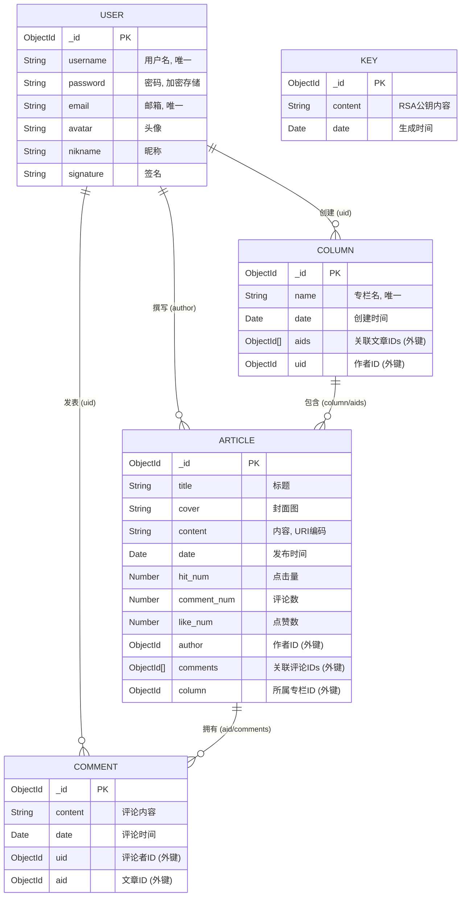

# express 注册登录案例

>  实现 **前后端分离**的注册登录案例, 实现 **RSA加密** **jwt-Token验证** **前端后端数据校验**

# server 服务端

### 接口

- 登录 login POST
- 注册 register POST
- 公钥获取 getPublicKey GET
- 上传文件 upload POST
- 鉴权 
    访客 无登录 无鉴权
      GET 
        articles
        comments
        keys
        cloumns
        search 
      POST 
        comments
        admin/regiseter

    用户 登录 鉴权
      GET
        articles 
        comments
        cloumns
        keys
        search
      POST
        articles 
        comments
        cloumns 
        upload 
    
      JWT 需要验证token的api
        POST 
          articles
          cloumns
          upload
        PUT
          articles
          cloumns
          userInfo
        DELETE
          articles
          cloumns
          userInfo

### 测试_id
columns 5fdb555c0b8ae033f874e728
users 5fd8bc3eaac2672638f9d8dc
articles 5fdca8c6b5c4b9066085fcec
### 模块

- User管理模块 ['添加','查询','验证']
- Key管理模块 ['生成秘钥','获取公钥','加密','解密'] 
- jsonwebtoken ['创建Token']
- validate 内容校验模块 ['账号格式','密码格式','长度','必填','返回语']
- statusCode管理 自定义状态码 ['账号或密码错误','Token错误','Token失效','账号已存在','账号格式不正确','密码格式不正确','登录成功','注册成功']

### 中间件

- CORS 跨域 携带 Cookie
- express-JWT 验证Token


## client 客户端

### UI 

layerUI 


### 库

jQuery  axios  jsencrypt 


### 页面

login.html

index.html


### 业务流程


```
##文件上传
 1. 用户头像 avatar  avatar
 2. 文章中的  article
 3. 文章封面  article

 所有文件上传前端都走单独接口 单独事件

 用户选择文件后 拖拽放入文件后 直接http 上传接口

 路由接收请求后 存储图片到 uploads文件夹

 接口 返回 此文件对应的 静态资源路径


  request query
    file: 文件
    uid: 用户_id  如果 params.classIfy是user 必须给uid


 文章 wangEditor
 插入图片 => http请求 返回url
 

```


##API

登录 /admin/login
注册 /admin/register

获取公钥

资源
  /api/rest/:resource

  resource

列表接口 (分页)
  获取文章列表
  获取评论列表
  获取分类列表
  获取用户列表


## 创建资源关联model
  post 
    添加一条评论的时候 要找到对应aid的文章 comments字段push添加评论id
    Comment
      ref aid : Article:{
        comments:{
          $push: commentId
        }
    }
    添加一篇文章的时候 要找到对应分类 aids字段push添加文章aid
    Article
      ref column: Column:{
        aids:{
          $push: aid
        }
    }


# Blog Server 后端服务 (Node.js + Express + MongoDB)

基于 Node.js + Express + MongoDB (Mongoose) 构建的博客系统后端 API，包含用户鉴权、文章管理、专栏分类、评论系统及 RSA 非对称加密传输。

## 🛠️ 技术栈
- **运行环境**: Node.js
- **Web 框架**: Express
- **数据库**: MongoDB (Mongoose)
- **安全与鉴权**: JWT (jsonwebtoken) + RSA (node-rsa) + JWT (express-jwt)
- **文件管理**: Multer (文件上传)
- **开发工具**: Nodemon (热更新)

## 📂 目录结构
```text
blog-server/
├── .vscode/
├── auth/            # 临时存放密钥
├── bin/            # 启动入口 (www)
├── core/           # 核心逻辑（工具函数、RSA控制等）
├── docs/api         # 项目api具体说明
├──     /db         # 项目数据库具体说明
├── middleware/         # bus总线经过这儿（我也不知道写什么了）
├── models/         # Mongoose 数据模型
├── node_modules/
├── plugins/        # 数据库连接等插件
├── public/         # 本地临时文件
├── routes/         # 路由控制器
├── uploads/         # 静态资源目录
├── config.js       # 全局配置文件（数据库地址、密钥路径等）
├── package.json
├── package-lock.json
├── README.md
├── .gitignore
└── app.js          # Express 应用配置
```

## 📂 核心数据模型
项目包含 5 个核心数据集合（详见 [DATABASE.md](./DATABASE.md)）：
1. `User`: 用户表（支持昵称、头像、签名，密码基于 RSA 加密传输）
2. `Column`: 专栏/分类表
3. `Article`: 文章表
4. `Comment`: 评论表
5. `Key`: 系统公钥/私钥存储表

## 🚀 快速开始

### 1. 环境准备
确保本地已安装并启动了 MongoDB 服务（默认端口 `27017`）。

### 2. 安装依赖
```bash
npm install
```

### 3. 开始
```bash
npm run start
```


### 📄 文档二：`DATABASE.md`（数据库设计说明文档）

你可以直接把以下内容复制到 `blog-server/DATABASE.md` 中。

```markdown
# 数据库设计说明 (Database Schema)

本项目采用 MongoDB 作为持久化存储，使用 Mongoose 进行 ODM 映射。共包含 5 个核心集合（Collection），分别是：`User`、`Column`、`Article`、`Comment`、`Key`。

## 📊 实体关系图 (ER Diagram)




